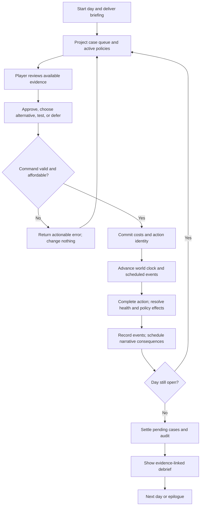
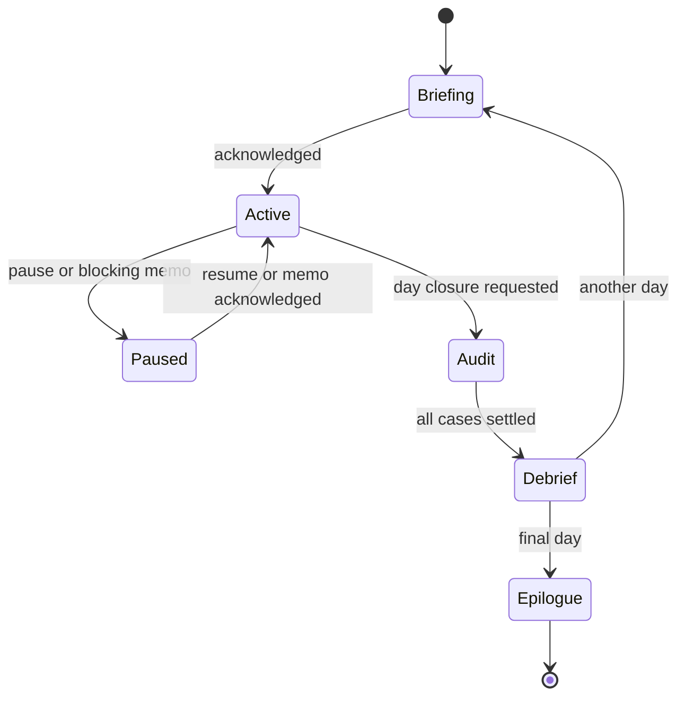
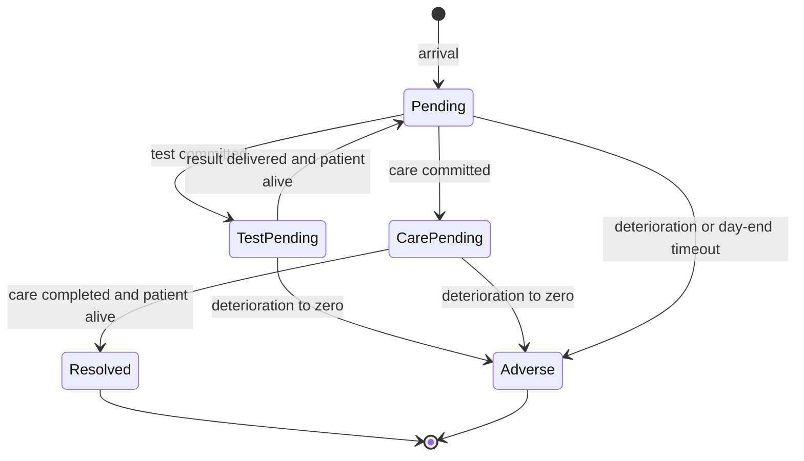

# Python architecture, loops, and graphs

## Responsibility boundaries

The core game works with a text adapter before the graphical interface is connected. Milestones 1–3 use the compact modules `hospital_game/domain.py`, `content.py`, `engine.py`, `policies.py`, `narrative.py`, `presentation.py`, `persistence.py`, and `cli.py`. The directory layout below is the longer-term target; split modules into packages when the next features justify it. See [implementation status](07-implementation-status.md) for the implemented subset of these contracts.

```text
hospital_game/
  domain/           # dataclasses/enums: GameState, CaseState, Command, Event
  engine/           # reducer, clock, resources, outcomes, policies, projections
  narrative/        # graph runner, condition interpreter, consequence scheduler
  content/          # loading, validation, authored case/policy/narrative assets
  presentation/     # immutable ViewModel, UI adapter protocol, text adapter
  persistence/      # versioned snapshots, event records, migrations
  optional_ai/      # text-only generation boundary and authored fallback
tests/
```

`domain` has no UI or network dependency. The engine reads validated content and emits events. Narrative consumes committed events and produces additional **typed engine commands**, never arbitrary state edits. Presentation receives a filtered snapshot and dispatches commands. Save/load reconstructs domain state without requiring a model call.

## Three different graph problems

| Structure | Purpose | Execution rule |
|---|---|---|
| Game/case state machines | Make illegal transitions impossible | Enumerated states and typed commands |
| Narrative graph | Select authored scenes and consequences | Data-driven conditions, explicit choices, ordered routes |
| Development/content workflow | Guide iterative implementation and authoring | Human-reviewed prompts with validation gates and bounded retries |

A separate model-orchestration library is not a prerequisite. Begin with ordinary Python functions and a small graph interpreter. Introduce a library only if later requirements exceed that implementation.

## Primary gameplay loop



The application/render loop is separate. Rendering frames, hovering, opening charts, and reading text do not run this simulation loop.

## State machines



Case lifecycle:



World time advances only during a committed action in the starter build, so intermediate states can be processed synchronously. Keep them explicit for save safety and later animation. No new player command may interrupt a synchronous action transaction. The implemented phases are `briefing`, `active`, `debrief` (when a post-audit choice waits), and `complete`; settlement and audit happen atomically inside closure. Paused actions and additional days in the diagram remain future work.

## State contract

`GameState` owns:

- `schema_version`, `content_version`, campaign identifier, deterministic seed/RNG state if randomness is later introduced.
- Day index, phase, current tick, remaining test capacity, visible funds.
- All case runtime states, revealed evidence IDs, selected care options, outcome settlements.
- Effective/acknowledged policy versions, exception decisions, immutable violation findings.
- Story flags, relationship flags, narrative cursor, queued consequences, fired one-shot triggers.
- Applied command IDs, ordered event IDs, and an incrementing state revision.

Use immutable input state and a pure transition function where practical:

```python
def dispatch(state: GameState, command: Command, content: Content) -> Transition:
    # Transition: next_state, events, errors; no filesystem/network/UI work.
    ...

def project(state: GameState, content: Content) -> ViewModel:
    # Explicit allowlist of player-visible fields.
    ...
```

For the local single-player build, validate a command's `expected_revision`, phase, target case, action, current recommendation ID, availability, cost, test capacity, and policy acknowledgement before mutation. A duplicate command ID returns its original result without charging or emitting events again. Check duplicates before stale revisions so a retried committed command remains harmless.

An approved recommendation binds to the displayed recommendation ID and care option. An alternative binds to a specified care option. A test binds to a test ID. Narrative choices bind to node and choice IDs. Never interpret an arbitrary text answer as a game command.

## Atomic action order

1. Validate command and construct the planned effects without changing state.
2. Capture the effective policy versions and evidence available at commitment.
3. Reserve resources, record action identity, and create an action-completion event.
4. Advance chronologically to the completion tick, splitting at scheduled events. Apply delay harm to pending patients over each elapsed interval.
5. For equal ticks: apply elapsed harm, then prior scheduled world events ordered by their sequence IDs, then the action completion. New arrivals have no damage for time before their arrival.
6. Complete care/test if the target is still eligible, evaluate policy obligations against the commitment snapshot, and apply one-time settlements.
7. Recompute derived workload; enqueue consequence events with idempotency keys.
8. Commit the new state, event sequence, and revision atomically; project a fresh view.

A blocking memo encountered during advancement suspends at its tick, retaining the committed action and remaining duration. Acknowledge it through a dedicated command, then finish the pending action under its captured policy version. The first slice can avoid mid-action memos, but must not implement retroactive policy evaluation.

If any internal calculation fails before commit, return the prior state. Persistence happens after a valid transition; use a temporary file and atomic replace so interrupted saving does not produce a half-written snapshot.

## Narrative execution contract

Each node has `id`, `kind`, text/template reference, and outgoing edges. Node kinds:

- `auto`: choose the highest-priority satisfied nonfallback edge, otherwise the one unconditional fallback.
- `choice`: wait for one of the declared visible choice IDs. Each choice has exactly one outgoing edge in the starter format.
- `event`: wait for the exact named committed engine event. Each accepted event has exactly one outgoing edge in the starter format.
- `terminal`: stop; it has no outgoing edges.

Priorities are distinct within an auto node; larger numbers win. Fallback is explicit and lowest priority. Every declared choice/event must have an edge, and unknown choices/events are rejected. Choice/event nodes do not spontaneously advance.

Conditions are data, not code. The starter format supports one primitive comparison: `{ "field": "policy_findings", "op": "gte", "value": 1 }`. Approved fields and operators are registered and type-checked. Never use Python `eval`. Later `all`/`any`/`not` conditions need explicit recursive parsing, depth limits, tests, and a version bump.

Use branching and reconvergence to control content size: a staff conversation may branch into two responses, set a flag, and rejoin the case queue. Later scenes read the flag. Do not duplicate the entire campaign after every decision.

The starter graph is a DAG: cycles are rejected. A future repeatable graph may allow a loop only with a visit budget and explicit exit; a runtime step budget must still stop accidental auto-node loops. Waiting for player input does not count as an automatic step.

## Consequence scheduling

Represent delayed consequences as data:

```json
{
  "id": "family_letter_case_01",
  "trigger": {"event": "day_started", "day": 3},
  "guard": {"field": "case_01_outcome", "op": "eq", "value": "improved"},
  "effect": {"kind": "enqueue_scene", "scene_id": "family_letter_01"},
  "once_key": "case_01:family_letter"
}
```

This is the proposed later contract, not supported by the starter validator. Implement only after the day loop works. Register each guard field and each effect type. Set the `once_key` when an effect commits, persist it, and test that reloads or duplicate events cannot repeat payouts or penalties.

## UI integration

The presentation adapter exposes:

- `get_view() -> ViewModel`
- `dispatch(command) -> ActionResult`
- `save(path) -> None` and `load(path) -> None`; failures raise `SaveError` without changing the session
- `subscribe(listener)` or a simple polling equivalent, chosen after the UI framework is known.

The view includes visible health/funds, case queue, revealed evidence, AI statement and displayed confidence, active policy text, enabled actions, action costs, disabled reasons, current scene, and debrief. It excludes hidden truth, unrevealed tests, raw compliance values, future graph routes, and unrevealed outcomes.

Animations display committed results. They cannot determine whether an outcome occurs. Record the UI's action ID so double-clicks do not create duplicate decisions. Reading and pause behavior must be accessible; do not bind difficulty to reading speed by default.

## Save, replay, and diagnostics

Persist a versioned snapshot together with the event records that explain it. Start with snapshot restoration; event records are diagnostic history, not a second competing source of truth. Only claim event replay support after a tested reducer can reconstruct the same state.

Milestone 3 implements this in `persistence.py`. Format v1 contains the complete immutable `GameState`, plus save-format and content identity metadata. Strict decoding rejects unknown/missing fields, duplicate JSON keys, wrong scalar types (including booleans used as integers), unsupported enums/versions, non-finite numbers, and inconsistent records. The existing pure command reducer verifies receipts in an isolated state and compares every resulting field with the candidate snapshot. This validates reachability, event order, financial accounting, evidence, policy snapshots, and narrative history using the same rules as play. It never dispatches through the live session or emits events to UI consumers. The validated snapshot itself is restored; there is no event-log replay API or recovery by silently rebuilding a damaged snapshot.

Saves are allowed only between synchronous transactions, including briefing, active care, a post-audit choice, and a terminal ending. Intermediate `test_pending` / `care_pending` states cannot be saved. There are no suspended actions, scheduled consequence queues, generated text, or separate fired-trigger records yet; receipts, audit state, and narrative history preserve the implemented once-only behavior.

`save_game` validates before opening a sibling temporary file, writes UTF-8 JSON, flushes and fsyncs it, closes it, and uses `os.replace` on the same filesystem. Failure before replacement leaves the previous destination intact and attempts temporary-file cleanup. No fallible operation follows successful replacement. This guarantees atomic replacement, not directory-entry durability across sudden power loss. `Session.load` reads, validates, and projects a candidate before assigning it; failed loads leave the exact live state unchanged. Save/load do not increment revisions or simulation time. Loading an older save intentionally restores that earlier point and its command history.

Save v1 accepts at most 16 MiB and 10,000 committed commands. Validation processes the full receipt history, so large histories cost more than ordinary view reads; this is a bounded single-day format. Engine changes affecting stored state, event/receipt content, or transition semantics require a save version change and an explicit migration decision. No migration is currently implemented.

Store generated text if generation is later enabled; reloading must not generate a new story variation or reapply effects. Refuse unsupported save/content versions with a useful error. Do not silently combine old saves with changed case outcomes.

Debug tools may expose hidden values in an explicitly separate developer view. The normal UI and any runtime model input must use the allowlisted projection.
