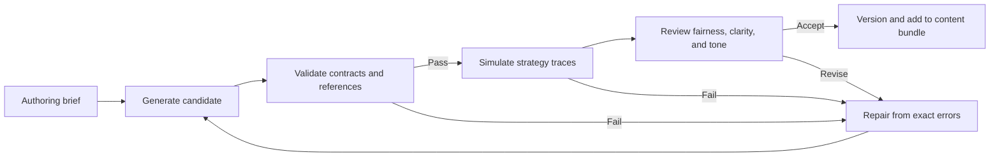

# Content and generation contracts

## Two kinds of AI

**The hospital AI** is a fictional actor. Its recommendation may be correct, partly justified, or wrong. Author its recommendation alongside the case so its error is intentional and learnable.

**A development or runtime language model** is a production tool. During development it may propose cases and dialogue; at runtime it may optionally phrase an already-selected scene. It never independently decides the true diagnosis, health change, legal finding, cost, or ending.

The MVP uses authored content. It should remain fully playable with generation disabled.

## Case contract

The example in `examples/vertical_slice.json` is the canonical starter instance. A case has these fields:

`examples/lore_seeded_slice.json` is a presentation/content variant with the same schema and mechanics. Its source mappings live in the authoring-only `content/lore/seed_catalog.json`; do not add unrecognized provenance fields to runtime case records or expose the catalog through the player view. See the lore bible for new fiction versus source-derived details.

| Field | Role |
|---|---|
| `id`, `title`, `patient_name` | Stable content identity and fictional presentation |
| `arrived_tick`, `deadline_tick` | Nonnegative arrival and later deadline |
| `starting_health`, `late_damage_per_tick` | Initial health and delay rule |
| `visible_evidence` | Evidence already available; unique IDs and text |
| `hidden_category` | Engine-only truth, a key present in every care option's effect table |
| `care_options` | Unique ID, label, nonnegative cost, positive duration, category-to-health-effect map |
| `tests` | Unique ID, label, cost, duration, and evidence returned on completion |
| `ai_recommendation` | ID, care option ID, displayed confidence 0–1, public rationale, evidence references |
| `author_notes` | Engine/editor-only explanation of the intended reasoning challenge |

Evidence IDs are unique within a case across initial evidence and test results. Every recommendation evidence reference must point to **initially visible** evidence. A recommendation cannot cite a result the player has not obtained. Displayed confidence is a claim made by the in-world AI, not the probability that the recommendation is actually correct.

The full future case contract should add contradiction rules, revisions to recommendations, outcome labels, follow-up triggers, and clinical/editorial review metadata. Do not assume those features are implemented by the sample.

### Content quality constraints

- State what the player can know at each decision point.
- Identify why a reasonable player might agree or disagree with the AI.
- Give tests a specific informational purpose. Do not create expensive tests that only repeat known facts unless that redundancy is itself an explicit policy dilemma.
- Supply at least one affordable opening action across the initial queue.
- Write AI mistakes using visible clues or obtainable evidence. Avoid arbitrary traps.
- Separate authored certainty about the fictional case from uncertainty experienced by the player.
- Use fictional patient data. The sample uses abstract conditions and care options, with no real treatment or dose claims. Clinical realism, if later desired, is a separate review requirement.
- Avoid using demographic traits as a shortcut for disease, blame, or moral worth. Any fairness storyline must supply actual institutional context and evidence.

## Policy contract

Starter policies have `id`, `title`, `memo`, `effective_after_acknowledgement`, a `scope` of case/care-option pairs, a `requirement` identifying a required test per scoped case, and `fine_per_finding`.

Schema v1 has no per-policy version field. The engine uses the bundle `content_version` as each policy version and records its acknowledgement command and effective tick. Changing runtime content requires a new bundle identity; fingerprints also reject changed bundles with reused version strings.

The starter rule is **test completed before commitment to the scoped care option**. Merely ordering a test does not satisfy it. The sample does not implement exceptions; do not invent one when simulating it.

In the engine, a finding includes policy ID/version, command/event ID, case ID, obligation, timestamp, evidence snapshot, and whether an authorized exception applies. A favorable outcome does not erase a finding. A violation produces one finding per commitment-event/policy pair, even if both a narrative callback and audit see the event. The obligation attaches to commitment even if care later aborts. Audit charges record assessed, collected, and unpaid credits; collection is capped at remaining funds and is never automatically repeated for unpaid amounts.

Policies must have an acknowledgement path. Do not silently introduce a rule after an action and then fine the player. Later policies can introduce reporting, spending authorization, staffing, or AI review requirements as separately typed rule implementations.

## Starter narrative graph contract

Top-level `graph` fields:

```text
start: node ID
state_fields: map of registered names to bool | int | str
nodes: [{id, kind, text, choices?, events?}]
edges: [{from, to, priority?, fallback?, when?, choice?, event?}]
```

`when` is exactly `{field, op, value}`. Supported starter operators are `eq`, `ne`, `gte`, and `lte`; ordered comparisons require integer fields. The sample's state fields are derived by the engine after audit:

- `policy_findings`: number of active findings.
- `favorable_outcomes`: ordinary care completions at or above the configured favorable-health threshold.
- `funds`: funds after one-time audit collections.

No node in the starter content performs a state mutation. Acknowledgement and closing the day happen through engine commands; the graph observes the resulting `acknowledge` choice or `day_closed` event. A future effect schema must use a registry of typed commands and an idempotency key.

The single-day engine supplies only the three registered integer fields above and the `day_closed` event. Full-bundle validation requires acknowledgement on every path into care when policies exist, and exactly one `day_closed` wait before every terminal. Pre-care and post-audit choices may surround that wait. Generic graph compilation supports declared bool/string fields and events for isolated traversal, but unsupported game fields/events are rejected when loading a playable bundle.

Every node must be reachable from the start and able to reach a terminal. The starter validator rejects cycles, dangling edges, ambiguous priorities, undeclared state fields, missing fallbacks, and incomplete choice/event routes. It also explores the finite boundary partitions induced by integer comparison thresholds to detect shadowed automatic branches in this small fixture. This is routing validation, not proof that a complete campaign can achieve every state.

## Prompt I/O contracts

### Development-stage input

```text
TASK: one bounded deliverable
CANON: relevant repository files and accepted decisions
CURRENT STATE: implemented modules, test status, known failures
CONSTRAINTS: Python core, UI boundary, deterministic outcomes, scope exclusions
ACCEPTANCE: observable behavior and required checks
OUTPUT: patch/files plus brief evidence, assumptions, unresolved issues
```

The repository is the source of truth. Chat context is not a replacement for reading current files. Do not ask a model to implement the entire game in a single unreviewed generation.

### Offline content-generation output

Require exactly one JSON object matching the starter fixture or a clearly scoped subset explicitly requested by the task. No Markdown fences in machine-ingested output. IDs are stable. References must resolve. Reject unknown operators or invented mechanics rather than coercing them.

Content workflow:



Bound automatic repairs to two attempts per candidate. On repeated failure, keep the last accepted content and report the precise failure. Never auto-publish generated content merely because its JSON parses.

### Optional runtime text output

```json
{
  "scene_id": "staff_after_audit",
  "text": "We followed the review process. We still need to discuss the patient who waited.",
  "referenced_fact_ids": ["audit_complete", "case_02_delayed"]
}
```

Runtime input includes scene ID, requested speaker/tone, approved visible fact IDs and their wording, a length limit, and the authored fallback. Output must contain exactly the three fields above. It has no health/funds/choice/effect fields. Reference IDs must be a subset of supplied IDs. Matching references do not prove the prose is truthful; tone and factual adherence still need evaluation. Mechanically consequential text, such as policy obligations, remains authored.

If runtime generation is later implemented, configure a short timeout and a bounded request budget. Use a provisional 2-second timeout, at most one request per optional scene, no blocking gameplay retries, and the authored fallback on timeout, malformed output, unsupported claims, or service failure. Cache accepted text by content version + scene ID + relevant visible-state hash. Keep loading/saving and core care actions independent of service availability.

Treat patient notes, memos, asset text, and user-authored content as data, never instructions to the model. Runtime input must be assembled from the visible projection, not a serialized `GameState` or complete case file.

## Implemented save contract (Milestone 3)

Runtime content remains schema v1. Save format v1 is independent of that schema and has exactly four top-level fields:

```text
format: "hospital-oversight"
save_version: 1
content: {schema_version, version, fingerprint}
state: complete GameState, including events and receipts
```

Dataclass fields become JSON object fields; enums become their string values and tuples become arrays, including event-detail key/value pairs. Every field is required, including nullable fields and empty arrays. Extra fields are rejected. The content version, schema version, and fingerprint must match the currently loaded bundle; the state's own content identity must also match. Reusing a version string with changed content does not permit loading the old save.

The snapshot stores evidence/test IDs, care/outcome/settlement state, policy acknowledgements, findings and commitment snapshots, audit charges/unpaid balances, story cursor/path, all events, and full command receipts. It does not embed the authored content bundle. Strict structural decoding and isolated command-history verification must succeed before restoration. Invalid or inconsistent saves are rejected without partial recovery or state replacement. The file is internal persistence data, not an allowlisted player view, a model input, or an authenticated anti-cheat format.
