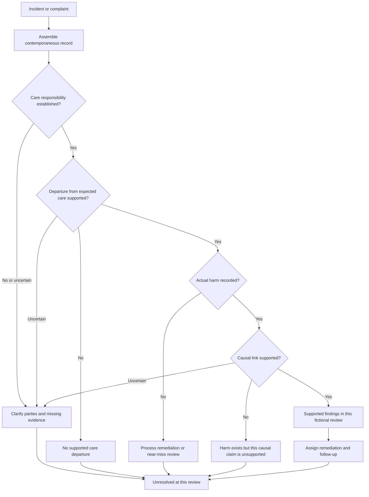

# Lore seeds for the hospital oversight game

The research archive now supplies patient identities, recurring dilemmas, and institutional tensions for the game. This document turns that material into a provisional setting and campaign. Source IDs resolve through [the provenance notes](06-lore-provenance.md) and `content/lore/source_manifest.json`.

**Status:** authoring canon for the next prototype, not a completed campaign or a representation of current medical/legal requirements. Patient names and background details below are carried from the archive where identified. Hospital, AI, staff names, dialogue, policies, schedules, and branch consequences are new fictional additions. These additions can be renamed to match the existing art.

## Setting and central conflict

**Northbank Community Hospital** serves a mixed urban and rural catchment. Its emergency department has more demand than staffed capacity. Management introduces **LANTERN**, a decision-support system supplied by **Meridian Clinical Systems**, to shorten review queues and protect the hospital's budget. The player is the clinician assigned to oversee its recommendations during a six-shift pilot.

The first recommendations save time. Problems emerge when summaries omit changes over time, authorization decisions arrive without a clear explanation, and a sudden shift in incoming patients exposes weaknesses in the system. The board wants the pilot to succeed; the staff need relief; patients want someone to listen. None of these goals is inherently malicious.

The hospital, vendor, and system names are new fiction. The pressure comes from the archive's staffed-bed discussion, model-drift scenario, and questions about responsibility across clinicians, hospitals, and developers. [S01: General Hospital Information; S01: Potential Scenario 1; S04; S09]

**Tone:** clipped administrative prose, tired but specific staff observations, and ordinary personal details. Reveal politics through memos, missing information, conversations, and follow-up letters. Use the game's research references for structural inspiration, without copying their characters, settings, or visual design. [S06]

## Recurring staff

All five characters and their lines are new fiction.

| Character | Role and pressure | Voice seed | Narrative use |
|---|---|---|---|
| Dr. Mara Voss | Medical director; must keep the pilot and staffed service viable | “A shorter queue matters only if the right people leave it.” | Budget pressure and a credible supporter of human review |
| Lena Ortiz | Charge nurse; sees deterioration across handovers | “The summary is from this morning. I am telling you what changed.” | Supplies observable contradictions, not omniscient diagnoses |
| Elias Chen | Compliance officer; needs a defensible event record | “Show me what was available when you made the decision.” | Separates policy audit, harm, and allegations of negligence |
| Nia Patel | Vendor liaison; can access technical material the ward cannot | “The aggregate score does not tell us how this queue behaves.” | Model-version disputes, local validation, and vendor transparency |
| Sam Reed | Patient liaison; translates process into human consequences | “They received the letter. They still do not know whom to call.” | Communication, accessible human review, and trust callbacks |

Characters can cooperate or disagree depending on recorded events. No character is always the ethical answer. Support comes from specific choices—hearing a concern, sharing an incident record, responding to a complaint—not an invisible morality total.

## Patient seeds carried from the archive

These are fictional patient concepts found in the supplied drafts, not the real litigants in the cited cases. Clinical labels are authoring context, not playable treatment protocols. Exact medications, probabilities, legal conclusions, and medical time windows are not imported into mechanics.

### Alexander Smoots

**From source:** 27-year-old man, compromised immune system, leg wound acquired around an old barn, uncertain injury object and vaccination history. The draft explores contaminated-wound risk and later monitoring. [S02: Alexander Smoots; S03: Alexander Smoots]

**Seed:** the AI summarizes “wound requiring closure”; Lena's intake note contains the exposure and unresolved history. The player decides whether to accept the compressed summary or obtain the missing background and escalate review. The key is noticing an omitted risk, not diagnosing tetanus merely from a barn injury.

**New callback:** a later letter asks whether anyone ever checked the missing record. It cites the actual history-review event. A timely review can lead to a reassuring follow-up; deterioration must be authored separately rather than guaranteed by the exposure.

### Timothy Martin

**From source:** 53-year-old man with no prior condition recorded; persistent headaches, soreness, fatigue, nausea, and a stress explanation. The patient-tree draft asks whether worsening symptoms and functional change should prompt further assessment. [S02: Patient 3 — Timothy Martin; S03: Timothy Martin and Filosa]

**Seed:** LANTERN anchors on the patient's explanation of work stress. A visible nursing note says the pattern is worsening; an additional assessment provides a stronger reason to escalate. This is the first adapted case in `examples/lore_seeded_slice.json`.

**New callback:** compare the original summary with later notes. The board asks what was knowable at each encounter, not whether the player guessed a hidden tumor. The cited appellate examples are not automatic plaintiff victories.

### Martha Valentine

**From source:** 31-year-old woman with urinary and pelvic symptoms; the draft considers deterioration beyond an initial routine interpretation. [S02: Martha Valentine; S03: Martha Valentine and Betti]

**Seed:** make her a returning patient so change over time is visible. The player must reconcile the earlier reassuring summary with new observations and make a concrete follow-up/escalation decision.

**New callback:** Sam asks whether the first discharge communication explained how to seek human help. An institutional communication failure and a later adverse outcome are reviewed on separate tracks. Do not turn the source's arbitration/timeliness cases into findings that malpractice occurred.

### Bartholomew Hasselbach

**From source:** 20-year-old man, no recorded underlying condition, breathlessness, cough, fever, and aches. The draft explores overlap between respiratory presentations and cardiac concerns. [S02: Barholomew/Bartholomew Hasselbach; S03: Rivera]

**Seed:** create two authored variants later. In one, visible changes justify more assessment; in the other, an initially reasonable interpretation remains reasonable given the evidence. This prevents “always order the expensive test” from becoming the lesson.

**New callback:** a difficult outcome need not produce a finding of negligence. Review the available evidence and the causal account separately. Use one variant per content version; do not secretly swap truth after a choice.

### Everleigh Paytas

**From source:** 33-year-old pregnant patient; flu-like/GI illness, food-exposure history, and the draft's concern about raw-milk exposure. [S02: Everliegh/Everleigh Paytas; S03: Consumers Union]

**Seed:** the important history is not volunteered in the first summary. The player can request a focused history review. Do not penalize them for missing facts that were neither visible nor obtainable.

**New callback:** the hospital must distinguish a public-information issue from responsibility for an individual care decision. The cited dairy case concerns advertising/warnings, not a malpractice verdict against this fictional patient's clinician.

### Tanner Boomba

**From source:** 20-year-old man, recent sports injury/concussion, worsening neck/head symptoms, and a prior benign explanation. [S02: Tanner Boomba; S03: Davies]

**Seed:** a return visit during the crisis creates pressure to reuse the earlier AI label. Changed symptoms are prominent in the new chart. The player chooses whether to revisit the earlier assessment.

**New callback:** the review distinguishes an allegation about missed diagnosis from a dispute about disclosure of a known treatment choice. Do not use a generic “consent violation” label for every adverse decision.

### Tammy Starr

**From source, lower confidence:** the explicitly experimental mock court-opinion section introduces a 41-year-old woman with a migraine history and a changed presentation including fever and neck stiffness. [S02: prompt-experiment section, Tammy Starr]

**Seed:** retain only the fictional identity and contrast between familiar history and new signs. An AI summary may overemphasize prior migraines while a contemporaneous note contradicts the familiar pattern.

**Do not carry over:** the mock judgment, asserted automatic vendor liability, treatment directions, or the claim that a lake exposure establishes a particular diagnosis. This seed remains an authoring draft and is not part of the initial slice.

### Morgan Vale

**New control patient:** retain Morgan from the original prototype as a routine case with an accurate recommendation. The source-informed campaign needs ordinary successful care as well as dramatic failures. Morgan's history and observations are explicitly fictional, not extracted from the archive.

## Policy and memo seeds

These are **invented Northbank policies**, informed by themes in the archive. Their identifiers and consequences are not statutes. Except `P01`, these require future engine commands and cannot be inserted as active rules into starter schema v1.

| ID | Introduced | Rule or institutional request | Decision tension | Source inspiration |
|---|---:|---|---|---|
| P01 | Day 1 | Complete a secondary assessment before pathway B commitment | Verification consumes a scarce assessment slot and action time | Existing prototype mechanic; documentation theme in S04 |
| P02 | Day 2 | Label AI-drafted patient messages and provide a human contact route | Faster communication vs meaningful human access | S01 communications/disclosure notes; S08 |
| P03 | Day 3 | Route disputed automated coverage decisions to a named human reviewer | Cash exposure and delay vs review of an unexplained decision | S01 Potential Scenario 2 and coverage notes |
| P04 | Day 4 | Use approved channels for vendor incident data; preserve the audit trail | Vendor needs detail; the ward needs a quick fix | S04 privacy/data sections; S09 information access |
| P05 | Day 5 | Record the deployed model version and restrict affected recommendations when a declared local-drift alert fires | Less automation during the busiest shift | S01 drift scenario; S09 contextual performance |
| P06 | Day 6 | Provide an incident account, named owner, and follow-up date | Admit uncertainty and fund remediation, or offer a narrower institutional response | S08 trust/accountability; S10 oversight analogy |

**Draft P01 memo, active fixture text:** Elias Chen announces a secondary-assessment gate for pathway B, effective after acknowledgement. Each missed gate generates one internal finding and a 45-credit budget penalty. This is the prototype's intentionally rigid administrative rule; it is not a real clinical recommendation to wait before urgent care. Costs and ticks remain game abstractions.

**Draft P02 memo:** “AI-drafted messages must identify their origin and give the patient a working route to a person. Approval means someone has checked both the wording and the contact details. A disclaimer with no reachable contact does not close the task.”

**Draft P03 memo:** “A recommendation about coverage is not a diagnosis. Send disputed decisions to the named reviewer and retain the evidence they considered. Record any delay and the hospital's interim commitment separately.”

**Draft P04 memo:** “The vendor has asked for the incident packet. Use the approved transfer channel and record the purpose and recipient. Preserve the original chart and recommendation version so the review can reconstruct what happened.”

**Draft P05 memo:** “Today's queue differs from the pilot sample. Preserve disagreement reports and the deployed version. The affected recommendation category requires the human review route until the local assessment is complete.”

**Draft P06 memo:** “The review is not complete when the form is filed. Each accepted corrective action needs an owner, a due date, and a way for the affected patient to reach us.”

## Six-day story outline

| Day | Episode | Case anchors | Institutional development | Later consequence |
|---|---|---|---|---|
| 1 | The pilot desk | Morgan + Timothy | P01; LANTERN is useful but can privilege an old explanation | Preserve the first disagreement record |
| 2 | The missing sentence | Alexander + ordinary cases | P02; a summary drops meaningful history | History review and patient-contact callback |
| 3 | Authorized does not mean assessed | Martha + follow-up cases | P03; care judgment and coverage diverge | Delay and expenditure reviewed independently |
| 4 | Whose evidence is it? | Everleigh + Bartholomew | P04; vendor requests incident details; local performance questions grow | Information-sharing choice affects the investigation |
| 5 | A different queue | Tanner + Tammy + established case types | P05; a neighboring service closure shifts the queue and staffing pressure | Earlier reporting/support changes available responses |
| 6 | The record and the repair | Follow-ups; no new surprise diagnostic puzzle | P06; patient letters, board review, remediation | Separate care, institutional, and trust outcomes |

The neighboring-service closure is new fictional scaffolding for the source's disruption/drift idea. It does not cause every AI recommendation to become wrong. Keep some accurate recommendations during the crisis, and make the alert observable before it affects choices.

## Review graph for a later milestone

The existing day-end graph evaluates only simulated outcomes, funds, and internal policy findings. A later **fictional case-review graph** can investigate allegations without equating all bad outcomes with wrongdoing:

This is a design outline, not executable graph data and not a legal decision procedure. Use authored `supported / unsupported / unresolved` assessments backed by event IDs. Courts, appeals, settlement, arbitration, and filing deadlines belong to separate authored procedural scenes if used at all. A finding against a hospital is not automatically a finding against its vendor or every clinician. [S03; S04; S09]

For ethical scene authoring, use **concern → threatened value → available response → cost → observable callback**. Example: a patient cannot reach a human → autonomy/accountability → arrange a contact and explain uncertainty → staff time → later confirmation the question was answered. This adapts the ethics and trust research into concrete decisions rather than a morality score. [S08; S11]

## Prototype boundary

`examples/lore_seeded_slice.json` contains Morgan and Timothy, P01, the staff voices, and the existing eight-node narrative graph. Its schema, IDs, numbers, and routing match the original mechanics fixture; only authoring/presentation text and content version differ. The Timothy scenario simplifies the source into “routine review versus further assessment,” without declaring a diagnosis or encoding treatment advice.

`content/lore/seed_catalog.json` is an authoring aid with source references. It is not loaded by the engine, not sent to a runtime model, and not checked by the starter content validator. Compile selected seeds into ordinary content before play. Source notes, hidden diagnoses, and future callbacks remain outside the player's projection.
