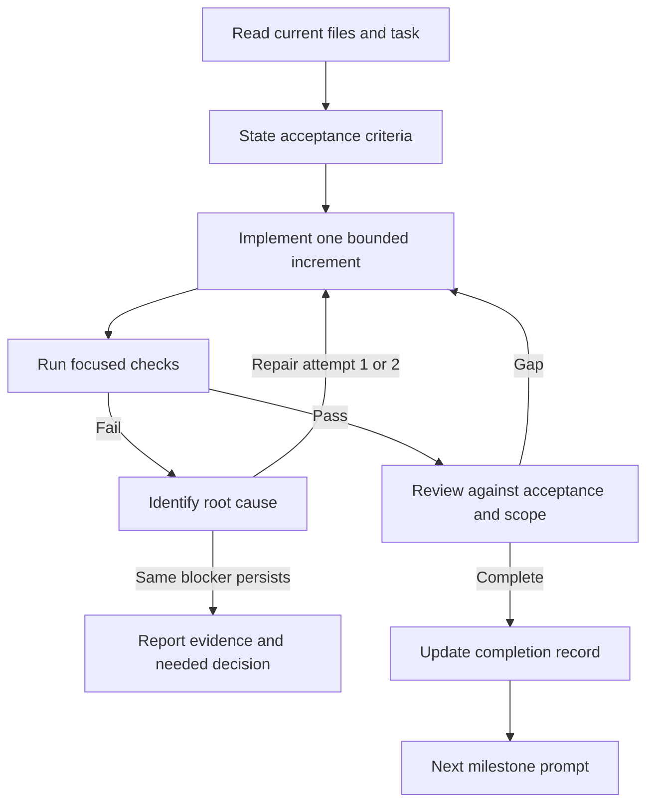

# How to run the prompt workflow

These are prompts for a coding/content assistant, not dialogue shown to the player. The runtime narration prompt is the one optional exception.

## First session

Paste `00-project-context.md`, then the appropriate stage prompt. Supply the paths of the actual repository and any assets. Replace bracketed task inputs with concrete values. If an input is unavailable, state that explicitly; do not leave placeholders that might be mistaken for content.

Use this kickoff request:

```text
Read prompts/00-project-context.md and docs/07-implementation-status.md.
Use docs/01-game-spec.md through docs/04-build-plan.md as the current design.
Inspect the repository before proposing changes. Record what exists versus what
is only specified. Milestone 1's deterministic core and terminal adapter now exist.
Use prompts/03-policy-and-story.md to implement the next bounded milestone.
Graphics/UI designs have been described but their files have not been supplied.
```

For lore-based content work, include `docs/05-lore-bible.md`, `docs/06-lore-provenance.md`, and selected entries from `content/lore/seed_catalog.json`. For example:

```text
Apply prompts/00-project-context.md and prompts/05-content-author.md.
Use the alexander_smoots seed for a Day 2 case about omitted history.
Read its source locators and constraints. Keep Northbank/LANTERN continuity.
Use starter schema v1 mechanics only; keep P02 as a future scene proposal
unless its required commands have actually been implemented. Separate
source-derived details from invented evidence and dialogue in the author
report. Validate the candidate and do not import the mock legal judgments.
```

For the original engine milestone (now implemented), the task template was:

```text
Apply prompts/00-project-context.md and prompts/02-domain-engine.md.
Implement Milestone 1 using examples/vertical_slice.json.
Keep outcomes deterministic and expose only an allowlisted view to presentation.
Run focused behavior tests and the existing content checks. Report exact files
changed, passing/failing checks, and remaining scope. Do not claim later
milestones are complete.
```

## Build loop



The two-attempt bound applies to repeated automated repair of the same failure, not a limit on thoughtful debugging. Stop blind retries; preserve the last valid result and surface what needs changing. Do not ask an assistant to approve its own work solely by saying that it looks correct. Use observable behavior, automated checks, and eventual playtests.

## Stage map

| Prompt | Inputs | Concrete output | Gate |
|---|---|---|---|
| 00 Context | Repository + current milestone | Shared rules | Read with every new coding session |
| 01 Scope | Specification + available assets | Contracts and decision record | No invented integration APIs |
| 02 Engine | Contracts + fixture | Pure Python core + text harness + tests | Deterministic care/resource loop |
| 03 Story | Engine + policy/graph data | Policy evaluator + graph runner | Independent compliance + valid routes |
| 04 Persistence/UI | Working core + actual designs | Save/load + adapters | State preserved; same mechanics across adapters |
| 05 Content | Phase, budget, learning objective | Candidate JSON + separate author report | Structural validity |
| 06 Review/repair | Candidate + exact failures | Review report or focused repair | Evidence-based content approval |
| 07 Runtime text | Visible facts + selected scene | Constrained text JSON | Optional, no mechanical authority |
| 08 Playtest | Versioned traces + observations | Prioritized tuning changes | Reproducible evidence |

## Session completion record

After each implementation stage, update a project decision/progress file with:

```text
Milestone and scope:
Implemented behavior:
Files changed:
Checks actually run and results:
Known limitations:
New assumptions or accepted decisions:
Next bounded task:
```

Prompt files are templates. They do not themselves execute a pipeline, contact a model, or authorize external publication. The game still needs to be implemented through the milestones.
